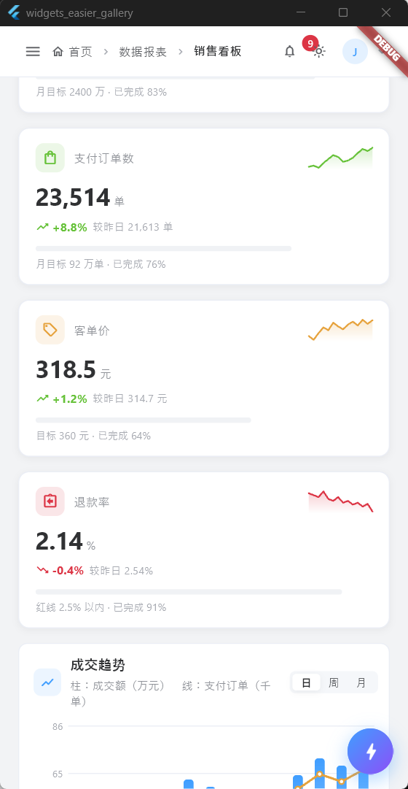
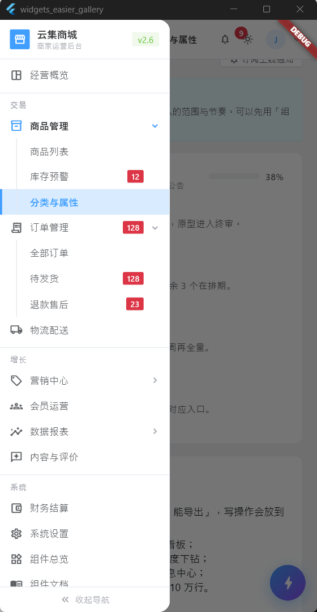
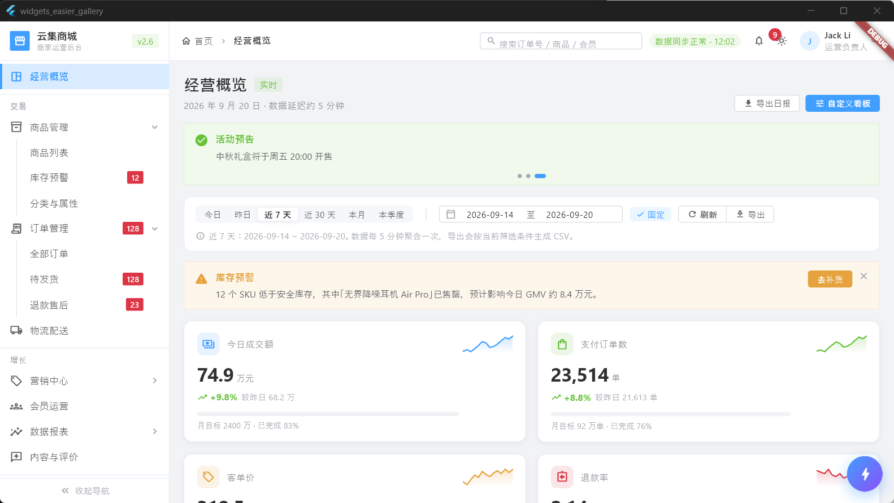
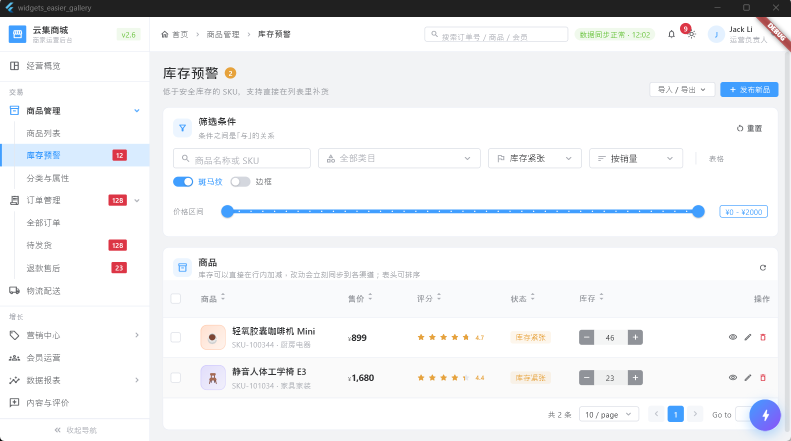
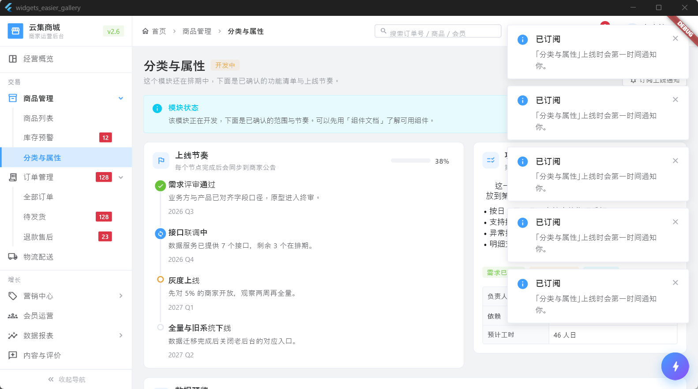
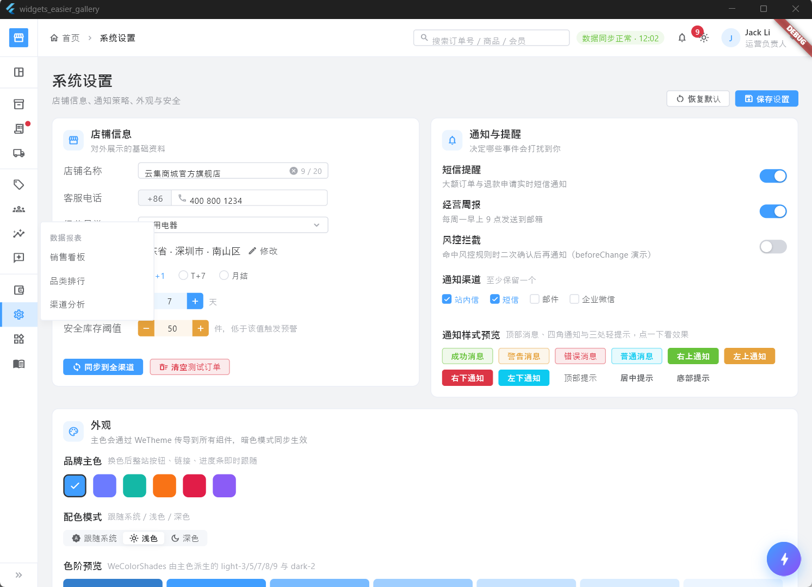
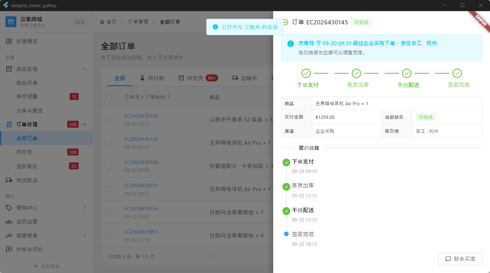

# widgets_easier_gallery

Gallery / documentation app for [widgets_easier](https://github.com/jacklee1995/widgets_easier) (requires `widgets_easier` and `widgets_easier_privacy_guard` >= 1.0.0, Flutter >= 3.35).

This app used to live in the widgets_easier monorepo and is now a standalone project. Until 1.0.0 is published on pub.dev, both packages are pulled from the `master` branch of the GitHub repository (see `pubspec.yaml`).

